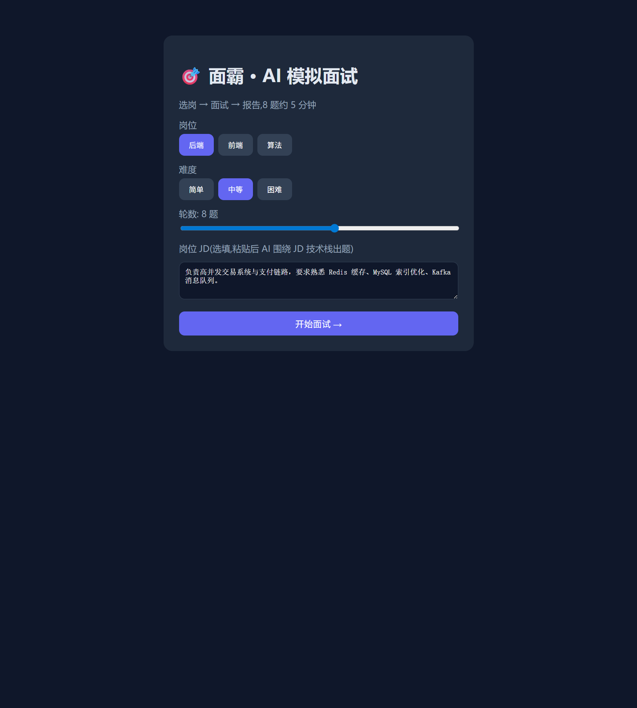
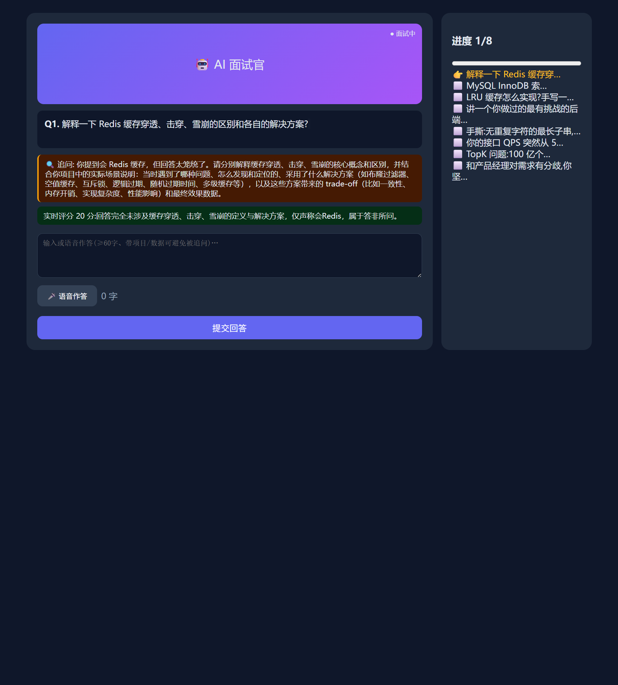
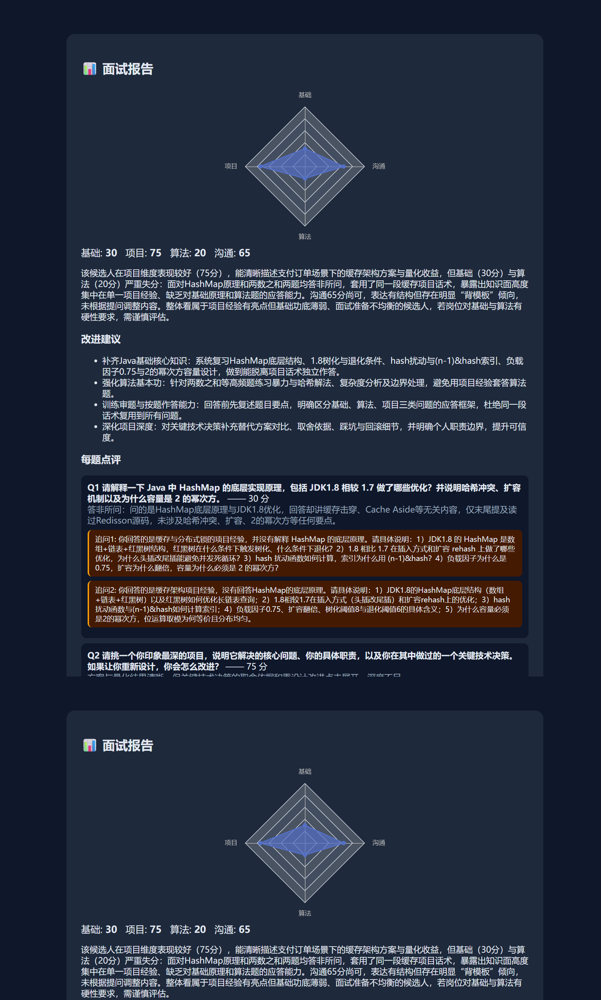

# 面霸 —— AI 智能模拟面试系统

> 选岗(可选粘贴 JD) → AI 流式提问 → 答浅自动追问 → 四维雷达图报告(可打印 PDF)

基于 **LangGraph 状态机** 的全栈 AI 面试应用:按岗位/难度动态出题,回答过浅自动深挖追问,
每题实时评分,终面输出基础/项目/算法/沟通四维能力评估。



## 亮点

### 1. 粘贴 JD,题目围着你的岗位出
配置页粘贴岗位 JD,大模型出题时围绕 JD 技术栈定制:



> 上图:粘的是"高并发支付链路/Redis/MySQL/Kafka",出的题就是支付链路缓存一致性、MySQL 订单事务、O(1) 空间 TopK——**不是通用八股**。
> 同时可见两个机制:橙色气泡是 LLM 对"我会 Redis"的**自动深挖追问**(进度不推进),绿色是**实时评分 20 分**并说明扣分理由。

### 2. 四维雷达图 + 可导出的评估报告



四维评分、每题点评、完整追问记录、总评与改进建议,一键打印导出 PDF。报告页支持
`?report=<session_id>` 直达,方便分享/复盘。

## 一键启动

```powershell
git clone https://github.com/dasandeyu-ll/mianba-ai-interview.git
cd mianba-ai-interview
copy backend\.env.example backend\.env   # 可选:填入 DEEPSEEK_API_KEY;不填也跑(本地题库+规则评分)
docker compose up --build
```

- 前端 http://localhost:5173 · 后端 http://localhost:8000 · 接口文档 http://localhost:8000/docs

**本地开发**

```powershell
# 后端
cd backend
pip install -r requirements.txt
uvicorn app.main:app --reload --port 8000

# 前端(另开终端)
cd frontend
npm install && npm run dev
```

## 全功能验证(28 项断言)

```powershell
cd backend
python -u verify.py        # 默认 5 题;--rounds N 改题数
```

覆盖:健康检查 / 非法轮数 422 / 出题四维约束 / 题号连续 / **JD 按岗出题** / SSE 题面一致 /
空回答 422 / 错误 session 404 / 浅回答必追问且不推进 / 同题最多追问 2 次 / 好回答高分通过 /
答完 finished / 终面再答 400 / 报告四维 0~100 / 点评条数==题数 / 追问记录 / 总评建议。

## 架构

```
React + Vite + ECharts(懒加载) + Web Speech
  │  REST + SSE(单向推送,比 WebSocket 轻)
  ▼
FastAPI  /start /answer /report /stream /state
  ├── LangGraph 状态机(按会话状态路由)
  │     generate(出题) → evaluate(追问判定+评分) → report(四维+总评)
  ├── DeepSeek 出题/判追问/打分 —— 全链路 Mock + 规则兜底
  ├── Pydantic 约束题型/轮数/报告结构;归一化 LLM 返回
  └── SQLite 持久化会话,支持断点续面
```

## 关键设计取舍

| 点 | 做法 | 为什么不用别的 |
|---|---|---|
| 前后端通信 | REST + SSE | WebSocket 要心跳/重连/房间管理,面试只是单向推题;轮询延迟高 |
| 流程编排 | LangGraph 状态机 | 纯 if-else 3 分支后就成面条;状态机可单节点重试、断点续跑、可视化 |
| 追问判定 | LLM 判深度 + 启发式兜底 | 纯 LLM 没 Key 就挂;纯关键词太死。双保险保证演示不翻车 |
| 评分 | LLM 打分 + 长度/采分点校准 | 直接信 LLM 会"5 个字给 75 分",校准后才有区分度、有据可依 |
| JD 出题 | JD 进提示词(轻量 RAG) | 8 题场景检索收益低,提示词注入已够贴岗,省一套向量库依赖 |
| 存储 | SQLite 单表 | 免运维 mysql 容器;换 SQLAlchemy 只改 db.py 一个文件 |
| PDF | 打印样式 + window.print() | 后端 reportlab 要调字体分页、样式难对齐,3 行代码已够 |
| 语音 | Web Speech(默认静音) | 浏览器原生零成本零 Key。默认关闭,控制台 `__speech_on()` 开 |

## 目录结构

```
backend/
  app/
    main.py       FastAPI 路由(start/answer/report/stream/state)
    graph.py      LangGraph 状态机(generate/evaluate/report)
    llm.py        DeepSeek 调用 + Mock 降级 + 归一化 + 评分校准
    schemas.py    Pydantic 约束(StartRequest/Question/Report)
    db.py         SQLite 持久化(断点续面)
  verify.py       28 项断言全链路回归
frontend/src/
  main.jsx        三步流程路由
  pages.jsx       配置/面试/报告三页
  api.js          REST + SSE + 语音封装
docs/             界面截图
```

## 环境要求

Python 3.11+ · Node 18+ · (可选) DeepSeek API Key
